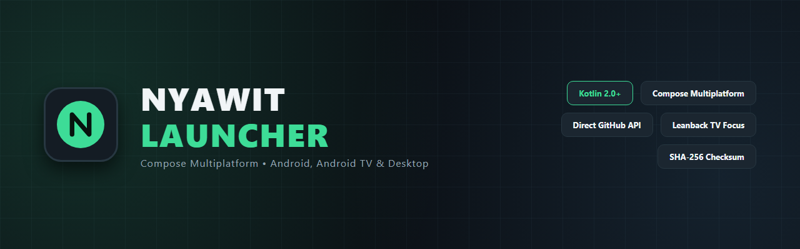
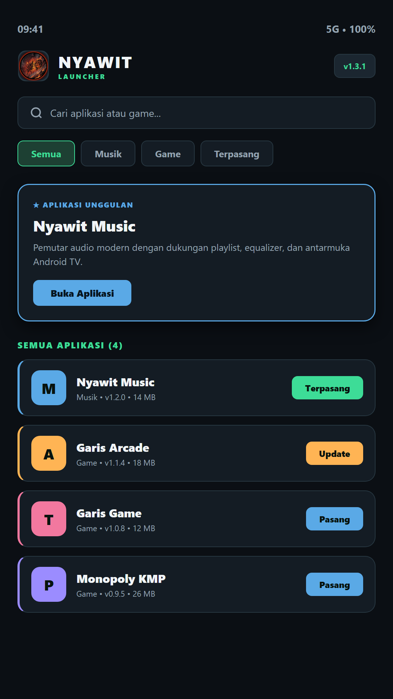
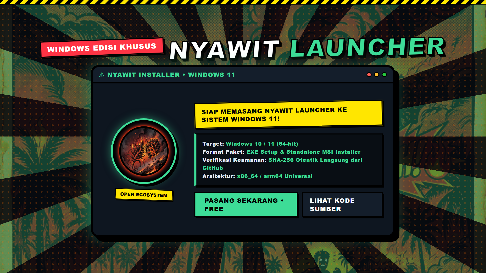
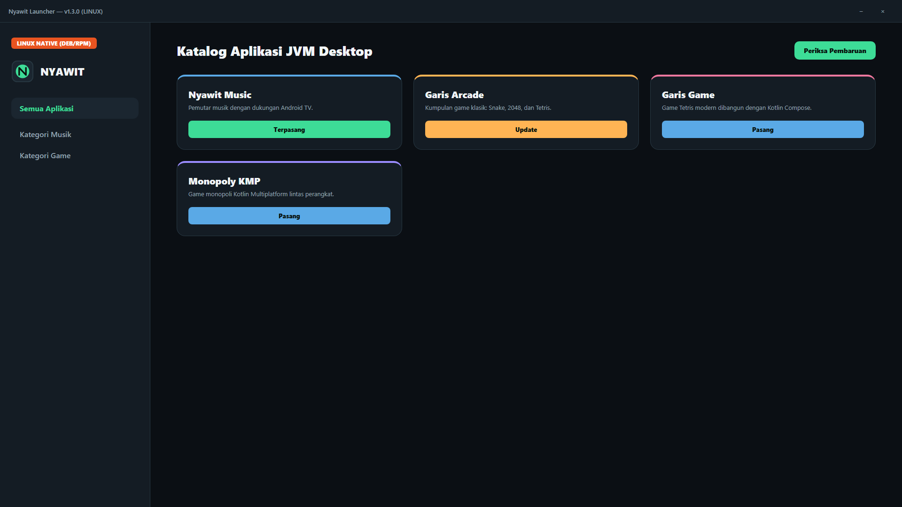
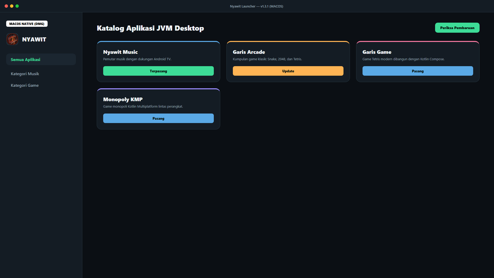
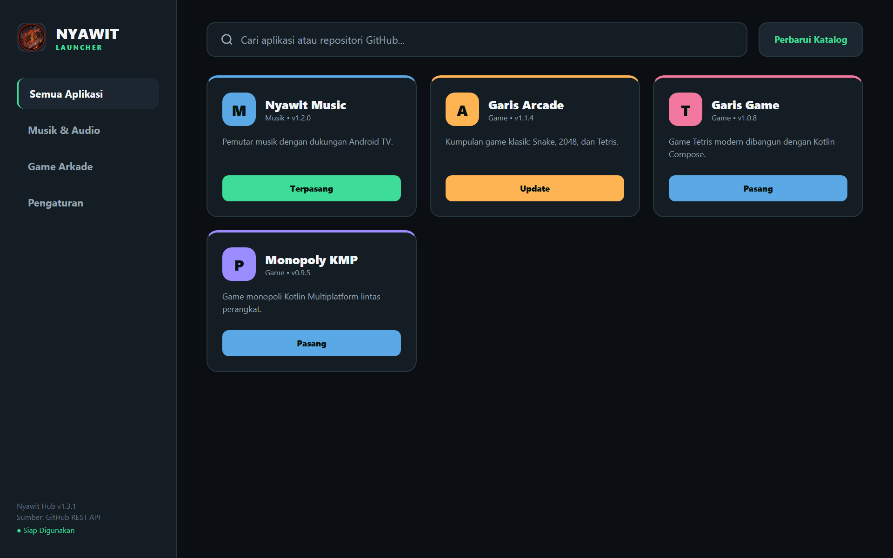
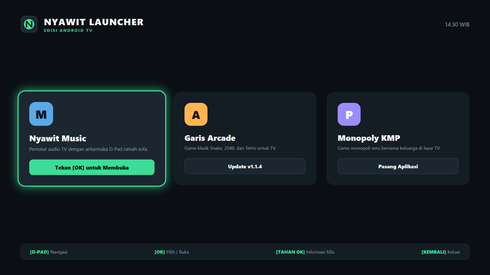

# Nyawit Launcher



Launcher Kotlin Multiplatform dengan Compose Multiplatform untuk **Android, Android TV, dan JVM/desktop**.

Tanpa server sendiri: katalog aplikasi diambil langsung dari GitHub REST API.

## Sumber katalog
- Konfigurasi sumber: https://github.com/nyawit-dev/nyawit-launcher/blob/main/catalog.json
- Launcher & katalog: https://github.com/nyawit-dev/nyawit-launcher
- Semua aplikasi: https://github.com/nyawit-dev

## Modul
- `shared` — UI Compose bersama
- `androidApp` — activity Android + launcher/Leanback
- `desktopApp` — window JVM

Audit fungsi inti dan alur lengkap: [`docs/CORE_FLOWS.md`](docs/CORE_FLOWS.md).

## Desain UI

Sistem desain memakai palet terbatas (navy `#0B0F14`, emerald `#3DDC97`, amber untuk peringatan, merah untuk error), skala tipografi eksplisit di `theme/Theme.kt`, dan komponen vektor yang digambar langsung (`core/ui/Icons.kt`, `BrandMark`). Tidak ada dekorasi berlebih — setiap warna dan elemen punya fungsi.

Tata letak:
- **Desktop/tablet** — sidebar kategori + status, area konten dengan pencarian, kartu unggulan (pinned), dan grid aplikasi.
- **HP** — header brand, pencarian, chip kategori, daftar vertikal.
- **TV** — header brand, grid 3 kolom dengan fokus D-pad.

State dimuat memakai skeleton placeholder, bukan spinner; dialog konfirmasi/update memakai bahasa yang jelas dan tombol yang eksplisit.

## Build
Semua build berjalan di GitHub Actions:
```bash
./gradlew :androidApp:assembleDebug :desktopApp:packageDistributionForCurrentOS
```

## Konfigurasi & versi

Satu sumber nilai ada di [`gradle.properties`](gradle.properties): versi, identitas aplikasi (`appId`, `appName`, vendor, dll.), URL katalog/GitHub, dan level SDK. Nilai-nilai ini dibaca oleh plugin `dev.nyawit.buildconfig` di [`build-logic/`](build-logic/) lalu:

- ditulis ke `BuildConfig.kt` di source set `shared/commonMain`, sehingga bisa dipakai kode Android, desktop, **dan UI Compose**;
- dipakai langsung oleh DSL `androidApp` (`applicationId`, `versionName`, `versionCode`, SDK) dan `desktopApp` (`packageName`, `packageVersion`, `bundleID`, dll.).

Untuk mengubah versi atau konfigurasi, edit `gradle.properties` — jangan mengubah hardcode di source. Rilis CI menimpa nilai lewat `-PreleaseVersion=... -PandroidVersionCode=...` sehingga hasil build tetap mengikuti tag.

`BuildConfig.kt` adalah file hasil generasi di `shared/build/generated/`; jangan diedit manual. Objek `AppMetadata` tetap ada sebagai fasad versi untuk kode lama. Versi yang ditampilkan UI untuk launcher sendiri selalu diambil dari `BuildConfig`, sehingga entri lama di `~/.nyawit-launcher/installed/` tidak bisa membuat versi tampak "nyangkut".

## Rilis

Rilis dipicu lewat **Actions → Release → Run workflow** dengan tag berformat `vX.Y.Z` (mis. `v1.3.1`). Tag divalidasi (format & belum dipakai), lalu versi artifact diambil otomatis dari tag:

- Android: `versionName = X.Y.Z`, `versionCode = X*10000 + Y*100 + Z`
- Desktop: `packageVersion = X.Y.Z` dan nama installer mengikuti versi
- Fallback versi di aplikasi juga dihasilkan dari tag saat build

Artifact yang dipublikasikan — **hanya installer native**:

| Platform | Artifact |
|---|---|
| Android | `.apk` release (ditandatangani, diverifikasi `apksigner`) |
| Windows | `.msi` dan `.exe` |
| Linux | `.deb` dan `.rpm` |
| macOS | `.dmg` untuk **Intel (x64)** dan **Apple Silicon (arm64)** |

Hanya installer native yang dirilis. Setiap artifact dibuatkan file `.sha256`; launcher memverifikasi checksum sebelum menyerahkan installer ke sistem operasi. Versi lintas platform dijamin sinkron karena berasal dari satu tag.

Alur pembaruan launcher: launcher mengecek rilis → **dialog konfirmasi** → mengunduh installer native → menyerahkan ke OS (`msiexec`, `xdg-open`, `open`, atau installer Android) → pengguna menyelesaikan pemasangan dan me-restart launcher.

> Keystore rilis Android saat ini masih disimpan di repo (`androidApp/release.jks`) agar tanda tangan APK lama tetap kompatibel. Memindahkannya ke GitHub Secrets akan mengubah signature dan mengharuskan pengguna lama menginstal ulang.

Lisensi: GPL-3.0.

## Menjalankan dari Android Studio

Konfigurasi Run sudah disimpan di folder [`.run/`](.run/) dan ikut ter-commit:

- **androidApp** — Android App: pilih perangkat/AVD lalu klik **Run** (membangun & menginstall APK otomatis).
- **desktopApp** — menjalankan `:desktopApp:run` (membuka jendela Compose Desktop).

Jika dropdown Run kosong, klik kanan file XML di `.run/` lalu pilih **Run**, atau buka **Edit Configurations → Import Run Configuration**.

Nama task Gradle untuk desktop: `./gradlew :desktopApp:run` (menjalankan aplikasi). Task `desktopRun` hanya *carrier* untuk IDE, sedangkan `hotRunDesktop`/`desktopRunHot` untuk hot reload.


## Katalog aplikasi

Launcher mengambil daftar aplikasi dari GitHub tanpa server. Konfigurasi ada di [`catalog.json`](catalog.json), dengan contoh lengkap di [`catalog.example.json`](catalog.example.json).

```json
{
  "sources": [
    {
      "owner": {
        "name": "nyawit-dev",
        "web": "https://nyawit-dev.github.io/"
      },
      "repo": [
        {
          "type": "repo",
          "name": "nyawit-dev/nyawit-music",
          "url": "https://github.com/nyawit-dev/nyawit-music",
          "label": "Nyawit Music",
          "description": "Deskripsi kartu aplikasi.",
          "category": "Musik",
          "platforms": ["android", "tv"],
          "packageName": "dev.nyawit.music",
          "accent": "#5AA9E6",
          "pinned": true
        },
        {
          "type": "app",
          "name": "aplikasi-manual",
          "label": "Aplikasi Manual"
        }
      ]
    }
  ]
}
```

Entri `user`/`org` dan `exclude` bersifat opsional untuk auto-discovery; `catalog.json` saat ini tidak memakainya, jadi **hanya aplikasi yang dicantumkan eksplisit** yang tampil.

**Grup `owner` + `repo`:** mengelompokkan banyak aplikasi di bawah satu pemilik. `owner.name` dipakai sebagai prefix default untuk entri `app` yang `name`-nya tanpa `/`; `owner.web` ditampilkan di dialog detail aplikasi. Field detail pada tiap `repo` menimpa hasil deteksi otomatis.

**Jenis entri `type`:**
- `user` / `org` — memuat semua repo publik dari akun atau organisasi.
- `repo` — memuat satu repo GitHub. Bisa ditambah field detail untuk menimpa hasil deteksi otomatis.
- `app` — entri manual murni; `name` boleh hanya `nama-repo` (akan diawali `owner.name` grup, atau `nyawit-dev/` jika di luar grup) atau `owner/repo` lengkap. Tidak perlu repo terdeteksi otomatis.

**Field detail opsional (menimpa deteksi otomatis):**

| Field | Fungsi |
|---|---|
| `owner.name` / `owner.web` | Prefix default repo & alamat website di dialog detail |
| `url` | URL repo yang dipakai sebagai tautan "Sumber" & "Rilis" |
| `label` | Nama yang ditampilkan di kartu |
| `description` | Deskripsi di kartu & dialog detail |
| `category` | `Launcher`, `Game`, `Musik`, `Aplikasi`, atau teks bebas |
| `platforms` | Daftar `android`, `tv`, `desktop` |
| `packageName` | Package ID Android / kunci registry desktop (penting untuk cek update & tombol Buka) |
| `accent` | Warna kartu, format `#RRGGBB` atau `0xFFRRGGBB` |
| `hidden` | `true` untuk menyembunyikan entri ini (atau seluruh sumber `user`/`org`) |
| `pinned` | `true` untuk menampilkan aplikasi di urutan teratas |

`exclude` berisi daftar `owner/repo` yang ingin disembunyikan dari hasil deteksi `user`/`org`. Semua field bersifat opsional — konfigurasi lama yang hanya berisi `type` + `name` tetap berfungsi.

Urutan prioritas: entri `pinned` → repo `nyawit-dev` → sisanya berurutan berdasarkan nama. Entri `app` manual menimpa entri terdeteksi dengan `owner/repo` yang sama.

**Sumber konfigurasi saat runtime:** launcher selalu mencoba `https://raw.githubusercontent.com/nyawit-dev/nyawit-launcher/main/catalog.json` lebih dulu. Hasil unduhan disimpan ke cache lokal (`~/.nyawit-launcher/cache/catalog.json` di desktop, `<filesDir>/catalog.json` di Android). Saat Github tidak terjangkau, launcher membaca cache tersebut sehingga daftar aplikasi tetap muncul. Jika cache belum ada, launcher memakai katalog bawaan yang dibundel di aplikasi.

Untuk pengembangan desktop, file `catalog.json` di direktori kerja/induknya dipakai sebagai cadangan terakhir sebelum katalog bawaan — bukan menggantikan unduhan GitHub.

Agar perubahan langsung berlaku untuk pengguna rilis, tetap push `catalog.json` ke `main`.


## Menjalankan di Desktop

Installer native tersedia di halaman rilis: `.msi`/`.exe` (Windows), `.deb`/`.rpm` (Linux), dan `.dmg` (macOS, x64 & arm64). Untuk pengembangan, gunakan `./gradlew :desktopApp:run` atau konfigurasi **desktopApp** di Android Studio.

Saat memasang dari katalog, launcher memilih installer bawaan platform (`.msi`/`.exe`, `.deb`/`.rpm`, `.dmg`/`.pkg`, atau `.apk`). File diunduh ke `~/.nyawit-launcher/downloads/` (Android: `filesDir`), diverifikasi checksum SHA-256 bila tersedia, lalu diserahkan ke sistem operasi. Pemasangan hanya mendukung installer native sesuai platform; file format JAR tidak didukung.

Setelah unduhan selesai, installer **langsung dijalankan otomatis** (Windows: `msiexec /quiet` untuk MSI dan mode silent untuk EXE) tanpa perlu konfirmasi tambahan. Tombol **Lanjutkan** hanya muncul bila proses peluncuran installer gagal, untuk mencoba lagi dari file yang sudah terunduh tanpa mengunduh ulang. Di Android, berikan izin *Install unknown apps* bila diminta, lalu konfirmasi di installer sistem.

Jika rilis aplikasi tidak menyediakan installer untuk platform Anda, launcher menampilkan pesan "tidak menyediakan installer untuk platform ini" — misalnya `Nyawit Music` saat ini hanya memiliki `.apk`, sehingga bisa dipasang di Android tetapi bukan di desktop.

Pembaruan launcher menampilkan dialog konfirmasi, lalu dialog progres saat mengunduh installer. Setelah installer selesai, restart launcher secara manual.

Ikon native tersedia di `desktopApp/icons/` (`windows/nyawit.ico`, `linux/nyawit.png`, `mac/nyawit.icns`). Ikon jendela memakai versi kotak 512×512 agar tidak gepeng di taskbar. Di Windows, MSI membuat pintasan Desktop dan entri Start Menu **Nyawit → Nyawit Launcher** dengan UUID upgrade tetap.

## Galeri

| Android | Windows | Linux | macOS |
|---|---|---|---|
|  |  |  |  |

Tampilan tablet:  · Android TV: 

Aset promosi dan metadata toko aplikasi ada di [`play/`](play/) — lihat [`play/README.md`](play/README.md). Preview sosial: [`docs/images/social-preview.png`](docs/images/social-preview.png). Daftar lengkap aset: [`docs/ASSETS.md`](docs/ASSETS.md).
